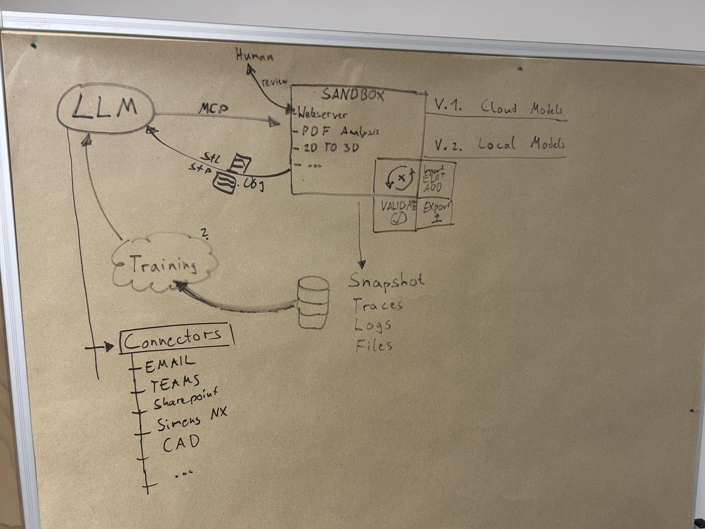

# 11 – Connectors, Artifact Hand-off & V2 (Local Models, Fine-tuning)

Status: **Draft**. Connectors are named and shown in the demo, not implemented. V2 is a separate
stage after V1 ([roadmap](10-roadmap.md)). The data rules below apply from V1 on, because the data
we collect in V1 decides what is possible in V2.

## Team whiteboard (2026-10-16)



| Whiteboard | Where it is specified |
|---|---|
| LLM → MCP → Sandbox (webserver, PDF analysis, 2D to 3D) | [02](02-architecture.md), [04](04-drawing-analysis.md), [05](05-cad-mcp-server.md) |
| Webserver → human review | [06](06-review-app-and-hitl.md) |
| Loop Import/Edit/Add → Validate → Export | [05](05-cad-mcp-server.md) (incl. `import_step`) |
| STL/STEP/OBJ back to the LLM | Artifact hand-off (below) |
| Snapshot, traces, logs, files → database | [07](07-sandbox-and-storage.md), [08](08-observability-and-logging.md) |
| V.1 cloud models, V.2 local models | [Roadmap](10-roadmap.md): V1 cloud only, V2 local models + fine-tuning |
| Database → training → LLM ("2.") | V2 (below) |
| Connectors: Email, Teams, SharePoint, Siemens NX, CAD, … | Connectors (below): named, shown in the demo |

## Artifact hand-off (V1)

Exported files are **saved to storage first**. The agent then receives **artifact references**, not
file contents. With connectors (later) it can pass them on to send, save or process them elsewhere.

```json
{
  "artifact_id": "art-…",
  "uri": "artifact://ses-…/build-…/part.ap242.step",
  "format": "step-ap242",
  "bytes": 48211,
  "sha256": "…",
  "session_id": "ses-…",
  "build_id": "build-…",
  "validation_passed": true,
  "review_status": "approved"
}
```

Rules:

- `artifact://` URIs are resolved through the **session manager / storage API**, never from inside a sandbox.
- For its own reasoning the model gets the `ValidationReport` and **rendered views** (`render_views`), not STEP/STL/OBJ bytes.
- Once connectors exist: every outbound transfer needs **human confirmation**, artifacts with open
  `blocking` review items cannot be sent, and each transfer is an `artifact.handed_off` event.

## Connectors

**Scope: named in the architecture and shown in the demo as planned integrations. Not implemented
in V1 or V2.**

| Connector | Planned use |
|---|---|
| **Email** | Drawing arrives by mail → new session; result sent back |
| **Microsoft Teams** | Notifications, review links, approvals |
| **SharePoint** | Drawing folders in, results out |
| **Siemens NX** | Open/validate STEP in NX, native `.prt` output (NX Open API) |
| **Other CAD / PLM / PDM** | Exchange with further systems |

Email, Teams and SharePoint can share one Microsoft Graph connector. AnythingMCP may fit this layer
later (wrapping existing enterprise APIs; see D25).

Design rules for when they are built (so V1 does not block them):

- Each connector is its **own MCP server at agent level** (host side). Sandboxes stay offline.
- Least-privilege scopes, credentials only on the host, every call logged as an event.
- Incoming content (emails, documents) is untrusted data, never instructions (prompt injection).
- Outbound actions need human confirmation (see artifact hand-off).

## V2 – Local models & fine-tuning

A separate stage after V1. V1 is built and tuned with cloud models only.

### Local models

- Run the same agent and MCP servers with a local model via `init_chat_model` (e.g. Ollama).
- Local OCR for the raster path (open point T12).
- The test bench ([09](09-evaluation-and-test-data.md#test-bench)) compares local vs cloud results on the same test sets.

### Data we already collect in V1

The event log and snapshots ([07](07-sandbox-and-storage.md), [08](08-observability-and-logging.md))
contain drawings, label crops, model inputs/outputs, specs, human corrections, feature lists,
validation results and approvals. Training is a downstream use of this data.

### Steps

| Step | What |
|---|---|
| **a. Dataset export** | Turn shelved sessions into versioned training records (below) |
| **b. Curation** | Humans check records and mark them gold / usable / rejected in the review app |
| **c. Examples instead of training** | Retrieve similar approved sessions as worked examples in the prompt |
| **d. Fine-tuning** | Fine-tune a small local vision model on label reading and spec extraction |
| **e. Promotion** | Adopt a model only if it beats the current one on the test bench without regressions |

### Training record

```python
class DatasetRecord(BaseModel):
    record_id: str
    task: Literal["label_reading", "spec_extraction", "feature_planning", "repair"]
    input_refs: list[str]            # artifact URIs: drawing crop / sheet render / spec
    target: dict                     # human-approved output (label text, spec, feature list)
    model_output: dict | None        # what the model produced before correction
    corrections: list[ReviewAction]  # human edits between model output and target
    source_session: str
    source_snapshot: str
    split: Literal["train", "val", "eval", "excluded"]
    consent: Literal["training_allowed", "eval_only", "not_allowed"]
    curation: Literal["uncurated", "gold", "usable", "rejected"]
    curated_by: str | None
    curated_at: str | None
```

Datasets are **versioned** (`dataset-<name>-vN`, manifest with record IDs and hashes), so every
fine-tuned model can be traced back to the exact data.

### Rules (apply from V1 on)

1. **No training on test data.** The 9 sample parts and every test bench case are `split = eval`
   forever. Splits are assigned **per part**, never per record.
2. **Only human-approved targets.** Unreviewed model output is never a training label.
3. **Consent per session.** Each session records whether its data may be used for training.
   Customer drawings default to `not_allowed` until permission is documented.
4. **Retention wins.** A record cannot outlive the retention of its source session unless consent
   and retention class explicitly allow it.
5. **Traceability.** Every record links to its session, snapshot and the human decisions behind it.

### Curation and training UI

No separate frontend. Dataset curation is a **"Datasets" section in the review app**, because
curating a record is re-reviewing a session (same overlays, 3D view, spec, events):

| Screen | Content |
|---|---|
| **Records** | Filter by task, split, consent, curation status, part, model; queue of uncurated records |
| **Record view** | Drawing crop/sheet with overlays, model output vs approved target (diff), corrections, link to session timeline. Actions: mark gold / usable / rejected, fix target, change split (with reason) |
| **Dataset versions** | Freeze a version, view manifest and statistics, diff between versions |
| **Training runs** | Thin page: pick dataset version + base model + recipe, start a job, show status, link to experiment tracking, show test bench results vs the current model |

We do **not** build a training stack. Fine-tuning uses existing open-source tooling (candidates:
LLaMA-Factory, Unsloth, Axolotl) with MLflow for experiment tracking and model registry.
