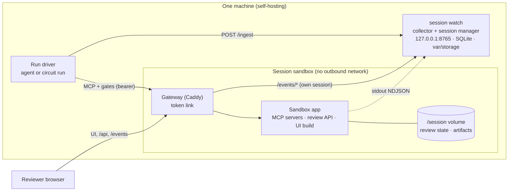
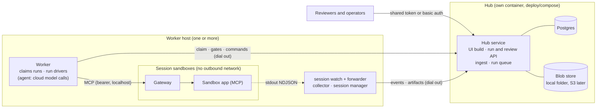

# 13 – Shared Frontend, Hosted Hub & Central Store

Status: **Decided, being implemented** (spike #48); step 5, the read-only hub v0, is in
([Hub v0](#hub-v0-74), #74). Decisions D72–D75 and D79–D83 (team, 2026-10-17); D87 (batch queue)
and D88 (MCP endpoints for an org) by @real-oskar the same day; D99 (hub v0 mirror rules,
accepted as a temporary v0 rule).

**Hackathon scope** (team, 2026-10-17, due 18 Oct): the full hub, migration steps 1–7 below,
including gates at the hub and the worker queue; the mode 2 part of #52 (downloads and shelve as
hub commands) and step 8 come later. The worker queue follows D87.

## Summary

- **One review frontend** (the React build of D55) for **both MCP servers** (Drawing2CAD parts and
  circuits) and **two deployment modes**, configured at runtime by a small `config.json`.
- **Mode 1, in the sandbox:** as today. One sandbox = one plan, the UI and review API are served
  by the sandbox behind its token link, events come from the host collector, everything offline.
- **Mode 2, hosted:** a new **hub** container serves the same UI build, an overview table across all
  runs and the run/review API, backed by **Postgres + a blob store** (D72). Sandboxes serve no UI.
- **Workers dial out** (D79): on each sandbox host a worker claims queued runs, runs the
  agent or circuit driver, and pushes events and artifacts to the hub. The hub never connects into
  a sandbox or a worker host.
- **The UI only records decisions** (D75). Gates, POI actions and corrections go to the review API;
  the run driver picks them up and changes domain state through MCP, in both modes.
- **Migration:** frontend first (config, routes, run-kind panels, circuit panels), then repository
  interfaces, then the hub read-only, then gates, queue and auth. Mode 1 works after every step.

## Two deployment modes

| | Mode 1 – in the sandbox | Mode 2 – hosted hub |
|---|---|---|
| Who | One person, self-hosting; Claude Code or our agent with the MCP servers | A team or organisation; batch processing of many plans; the organisation's own MCP clients (D88) |
| UI served by | Sandbox app at `/` behind the gateway (D56); run table by `session watch` | Hub at `/` (overview) and `/runs/<run_id>` (run view) |
| Runs | One plan per sandbox; run driver started by hand (`agent start`, `circuit_mcp.run start`) | Queued at the hub (`POST /api/runs`, batches); a worker claims and starts them |
| Events | stdout → host collector (SQLite) → gateway `/events/*` (D61) | stdout → host collector → forwarder → hub (Postgres) → hub `/api/runs/<id>/events/*` |
| Review state | JSON in `/session/review` (D62) | Hub (Postgres, D80) |
| Artifacts | Session volume; snapshots in `var/storage/` | Copied out by the host, uploaded to the blob store |
| Decisions back | Run driver polls the sandbox review API | Run driver polls the hub review API (same contract) |
| Auth | Session token link (D56) | Shared token or basic auth (D73); worker token; users/orgs later |
| Network | Fully offline | Workers need outbound HTTPS to the hub (and to the model API, as today) |

### Mode 1



### Mode 1 jobs adapter for CAD add-ins (#119, D97)

A CAD add-in (the Fusion add-in in `F360_extension/`) talks to a small host service instead of the
CLI: `python -m mechatronikers.jobs serve`, next to `session watch`.

- **One job = one sandbox + one agent run.** `POST /jobs` (multipart `file`, a PDF of at most
  50 MB) starts a session with the drawing (`SessionManager.start`) and `agent run --yes` in the
  background, and returns `{job_id, review_url}`. The review URL is the sandbox's own token link;
  it goes only to the authenticated client, which opens it on the same machine. Credits are spent
  per job and the agent's budget guard applies (`MT_BUDGET_RUN`, `MT_BUDGET_TOTAL`).
- **Status from events, read-only.** `GET /jobs/{id}/wait` (long poll, at most 50 s) and
  `GET /jobs/{id}` read the run's host-trusted `agent.*` events: `done` after gate 2 is
  `approved` (with `step_url`); a plan rejected at gate 1 or a run aborted at the give-up gate is
  `rejected`; a failed step, the budget, a give-up without a gate, or an agent process that ended
  without a result is `error`, each with a plain reason. An update run is not final. A run with
  `agent.decision_untrusted` (builds without sandbox isolation, #104) is never `approved`: a
  build script could have written the decision, so the job ends as `error` with that reason.
- **No job holds a slot for good.** A job without a final decision ends after `--job-timeout-min`
  (45 min, longer than the add-in's own 30 min wait); `DELETE /jobs/{id}` cancels one. Both stop
  the run's process group and end the job as `error`; a shelved or failed sandbox ends it too. An
  upload whose client is gone (or that is cancelled) once its sandbox is up starts no run.
  `--max-active` (2) counts running jobs only, not sandboxes.
- **The STEP** is the run's last export, AP242 if present, else AP214, named by cad-mcp's
  `artifact.created` events of the job's own session, not by `agent.run_finished.build_id`
  (#101). The adapter reads it through the session gateway
  (`/api/review/artifacts/<build>/<file>`, with the session token, host side only), retries a
  failed read a few times (`job.fetch_failed`), and keeps it in `var/jobs/<id>/result.step`;
  `GET /download/{id}.step` serves only that job's own copy. A sandbox shelved before the read
  ends the job with that reason.
- **Security.** Bound to 127.0.0.1. Another host needs `--allow-remote` and
  `--review-host https://…`: the review link carries the session token, and the remote client must
  reach the gateway port through TLS forwarding the operator sets up. Every route needs
  `Authorization: Bearer <MT_JOBS_API_KEY>` (at least 16 characters, compared in constant time).
  Job records, `job.*` events and logs hold no gateway token: the agent's stdout, which prints the
  token link, is dropped; its stderr goes to `var/jobs/<id>/agent.log`.
- **State** lives in `var/jobs/<id>/job.json`, so a restart keeps the jobs; agent runs keep
  running in their own process group (after a restart, a pid counts as the run only while its
  command line names the module and the session). Finished jobs (drawing, STEP, log) are deleted
  after `--keep-days` (30, like the standard retention class). Sandboxes are not shelved
  automatically (D22): they keep running after a job ends, `session watch` reminds, and
  `session shelve <id> --yes` stops them.
- **Known limit:** the agent's spend ledger (`var/agent-spend.json`) is not safe for concurrent
  runs yet (fixed separately); until then, two runs that record a cost at the same moment can
  under-count `MT_BUDGET_TOTAL`.

### Mode 2



What stays the same in mode 2: sandboxes have no outbound route (D39), cloud models are called only
by the agent on the worker host (D7), API keys never enter a sandbox, the hub holds no model keys
and never parses an untrusted drawing (rendering happens in the sandbox).

## Answers to the spike questions

### 1. Data flow in mode 2: push (D79)

**Push from the host.** The sandbox cannot call out, so "push" means: the host-side collector,
which already reads every container's stdout, forwards events to the hub (`POST /api/ingest`,
NDJSON, de-duplicated by `emitter_id` + `seq` as today), and copies files out of the session
volume (like `SessionManager.copy_artifacts`) to upload them. The local SQLite store is the buffer:
a cursor per session (like `log_cursors`) resumes after a hub outage. Pull (the hub reads each
sandbox through its gateway) would need inbound connections to every worker host and fails for
shelved sandboxes.

| Data | Stored centrally | How |
|---|---|---|
| Events | yes, all | Forwarder → `events` table (body as JSONB, indexed columns) |
| Gates, decisions, POIs, actions | yes, authoritative (D80) | Review API of the hub |
| Specs (plan, dimensions, `CircuitSpec`) | yes | In the gate request (as today for parts) + latest spec file as artifact |
| Rendered sheets | yes | PNG rendered **in the sandbox** at analyse time (150 and 200 dpi), uploaded as artifact |
| 3D models, netlists, exports | yes | Artifacts (blob store + `artifacts` row), on `artifact.created` / `circuit.exported` |
| Input drawing / schematic | yes | Uploaded to the hub before the run (`inputs/` prefix) |
| Snapshots, log archives | yes | Uploaded at shelve time (doc 07 layout) |
| LangGraph checkpoints | no (hackathon) | SQLite on the worker host; a run resumes on the same worker. Later: Postgres checkpointer |

**Review state moves** out of `/session/review` in mode 2 instead of being mirrored (D80): one
writer, and a restarted sandbox or worker loses nothing. At shelve time the hub's rows for the
run are written into the snapshot as the same JSON files, so a snapshot restores in either mode.

**Event provenance (ingest rules).** Container stdout is untrusted: a model-written build script
can print a valid event line. In mode 1 the runner passes through only its own events and the
collector pins every container line to its session (doc 08, D86). The hub ingests by these rules:

- **Trusted emitters** are host processes only: the run driver (agent or circuit driver), the
  session manager and worker, and the hub itself. Everything read from a container is `container`.
- The forwarder **overwrites** `session_id` and `run_id` of container lines with that container's
  own session and run (never only fills them) and sends the source (`container` or `host`) with
  every line; the hub stores it.
- The hub accepts a line only if its session and run belong to the caller: a per-run token for its
  run, a worker token for the sessions of runs that worker claimed. Lines without `emitter_id` are
  rejected; `(emitter_id, seq)` stays unique.
- **State-driving events and fields** (`session.*`, `run.*`, `agent.*`, `review.*`, cost, status,
  phase) count only from trusted sources. Container events of those types are stored for the audit
  trail but flagged and ignored by summaries, phase rules and the overview table.
- **Spend** is settled from the worker's own budget report (`run.settled`), never summed from
  `model.response` events; negative costs are rejected.
- **No secrets in events.** No event carries a session's gateway token, or a link that holds it:
  `session.started` sends the port only, and the token link goes to the user (CLI) and the local run
  table, which read it from the session store. The hub therefore stores no gateway token (§5).

### 2. Decisions back to the run: the run driver polls the hub (D80)

- The run driver opens gates and polls exactly as today (D62), only against the hub's review API
  (same paths below a run base, same models, a per-run token). Gate ids are stable per run: the
  LangGraph interrupt id for parts, `gate-<run_id>-1` for circuits, so a restarted driver re-opens
  the same gate idempotently.
- No proxying from the hub to sandboxes (the "direct connection to the sandbox agent"): it would
  need inbound routes to worker hosts, and every outage of a sandbox would block the UI.
- **Sandbox or worker restarted:** gate state is in the hub. The agent resumes from its checkpoint
  (`agent resume`, parts only); the circuit driver has no checkpoint and re-runs its steps under the
  same run id. Both find the decision on their next poll.
- **Sandbox shelved while a gate is open:** the gate stays visible read-only and a decision returns
  409 "run shelved". Letting a decision trigger a `restore` command (the worker restores the session,
  the run reads the decision) is a later extension once restore exists.
- **Hub down:** drivers keep polling (they already retry on HTTP errors), forwarders buffer.

### 3. One build, two modes

- **Same `dist/`** in the sandbox image and the hub image. The two HTML entries (`index.html`,
  `table.html`) become one SPA entry with three routes and a tiny History-API router (no new
  dependency): `/` (run view in the sandbox, overview elsewhere), `/runs/<run_id>` (hub).
- **Runtime config** at `GET /config.json` (a file, not an inline script: CSP stays `script-src
  'self'`), served by whichever app serves the UI:

  ```
  {"mode": "sandbox", "api": {"run": "/api", "events": "/events", "circuit": "/circuit/api"},
   "features": {"table": false}, "links": {"runs": "http://127.0.0.1:8765/"}}
  {"mode": "host",    "api": {"runs": "/sessions"},              "features": {"table": true, "shelve": true}}
  {"mode": "hub",     "api": {"runs": "/api/runs"}, "auth": "basic",
   "features": {"table": true, "upload": true, "commands": true}}
  ```

  In the hub, the run view's bases come from the route: `run = /api/runs/<id>`,
  `events = /api/runs/<id>/events`. A circuit run reads its circuit from a third base, `circuit`:
  the sandbox's circuit add-on (`/circuit/api`, in the sandbox's config, #71), else `R/circuit`.
  The API client takes the bases; every component calls the client, never a hard-coded path
  (today `api/client.ts` hard-codes `/api/review`, `/events`, `/sessions`).
- **Paths:** assets stay absolute (`/assets/…`); both apps serve the UI at their origin root.
  Hosting under a sub-path is not needed and is not supported.
- **Run kind** comes from `agent.run_started.payload.kind` (`part` default, `circuit` already sent
  by the circuit run), so the sandbox app does not need to know it.
- **Mode 1 stays offline and small:** no CDN, fonts bundled (D55, D68); hub-only screens
  (overview, upload, commands) and each run kind's panels are lazy chunks, as the three.js viewer
  already is; a CI size check on the initial chunk keeps it that way.

### 4. Backend for mode 2: a new hub, not the collector grown (D75)

`session watch` is host-local by design (127.0.0.1, SQLite, Podman access, reminders). It stays the
**per-host** process and gains an opt-in forwarder and worker loop. The **hub** is a new Python
service (Starlette like the sandbox app, `mechatronikers.hub`), packaged as its own container with a
compose file under `deploy/compose/` (D72):

- reuses, via repository interfaces: the review store logic (`review_app/store.py`), the run summary
  and phase rules (`session/runs.py`), the collector's ingest semantics, the review API handlers
  (`create_review_api` mounted below `/api/runs/{run_id}`);
- has **no Podman access** and **no PDF parsing**; lifecycle actions (shelve, restore, cancel) are
  commands that a worker pulls and executes with the session manager;
- relation to the session manager: the worker owns sessions (start, follow, shelve); the hub owns
  runs, review state, artifacts index and the queue. Session rows in the hub are derived from
  `session.*` events of trusted emitters only (provenance rules above).

### 5. Auth and tenancy (D73, D82)

| Who | Hackathon | Later (designed, not built) |
|---|---|---|
| Browser ↔ hub | One shared credential: HTTP basic auth, or a token link that sets an HttpOnly cookie (same pattern as the gateway) | OIDC login; users, orgs, memberships with roles `viewer`, `reviewer`, `operator`, `admin`; every row carries `org_id` from day one (one default org now) |
| Worker ↔ hub | Worker token (`MT_HUB_TOKEN`): claim, commands; ingest and upload only for sessions of runs it claimed | Per-org worker tokens |
| Run driver ↔ hub | Per-run token minted at claim: only that run's gates, items and ingest | same |
| Test bench ↔ hub | Test bench token: test-set batches (the only caller that may set `auto_approve`, D57, §7), test cases, results; reads `testcases/` references | A test-bench role |
| Run driver ↔ sandbox | Per-session gateway token, never leaves the worker host: not in events (§1), not in the hub's `sessions` rows | same |
| MCP client ↔ hub | Per-client token for `/mcp/*` (D88); one client never reaches another client's sandbox | Per-user tokens (OIDC, D82) |
| Reviewer identity | Name once per browser session, recorded in every decision (D82) | The logged-in user (OIDC, D82) |

**Cross-site requests (CSRF).** Browsers attach cached basic-auth credentials to cross-site form
posts, and the review API parses bodies without checking their type. So every state-changing hub
route (`POST`, `PUT`, `DELETE`) requires:

- `Content-Type: application/json` for JSON bodies (else 415), so a plain cross-site form cannot
  send them;
- an `Origin` (or `Sec-Fetch-Site: same-origin`) check against the hub's own origin, `Referer` as
  a fallback; requests without any of them are rejected;
- a CSRF token for multipart uploads (`POST /api/runs`, test cases), delivered in `config.json` and
  sent as a header.

For browsers the token link with an HttpOnly `SameSite=Strict` cookie is preferred; basic auth (D73)
is allowed only together with these checks. Workers and drivers use bearer tokens and are not
affected. Mode 1 is already covered: the gateway's token cookie is `SameSite=Strict`
(`session/gateway.py`), and the agent uses a bearer token. The host run table's one write route,
`POST /sessions/<id>/shelve` (#52), applies the same JSON and `Origin`/`Sec-Fetch-Site` checks and
accepts only a loopback `Host` (no DNS rebinding).

**MCP endpoints for an org (D88, #85):** the hub exposes the drawing, CAD and circuit MCP servers
to an organisation's external MCP clients (Claude Desktop, Claude Code) at `/mcp/drawing`,
`/mcp/cad` and `/mcp/circuit` (streamable HTTP), behind hub auth with a per-client token. Each
client session is backed by its own worker sandbox, allocated by the hub; the MCP traffic is
relayed over the worker's outbound connection, so workers still dial out and the hub never connects
into a sandbox (D79). API keys never enter a sandbox. Per-org limits on concurrent sessions and
budget apply as for runs (D87); allocation and release are events, and a disconnect or idle
timeout shelves the sandbox (D22). Builds on the workers and the queue (#76, #77). Mode 1 stays
available for self-hosted MCP clients.

### 6. Domain boundary (D74, D75)

| Shared (both kinds) | Per kind |
|---|---|
| Run, run summary, phase rules, events (`telemetry/events.py`), session lifecycle | `part`: `spec/part.py`, plan, dimensions, `ValidationReport` V0–V3, STL/GLB, update runs |
| Gates and decisions (`spec/review.py`), POIs (`ReviewItem`, `SourceRef`, `ReviewAction`), actions | `circuit`: `spec/circuit.py`, components, nets, `ErcReport`, netlists, ngspice operating point |
| **One checks shape**: today's `ValidationReport`, i.e. a `checks` list (scored) and an `advisory` list of `Check{id, category, passed, detail, feature_ids, expected?, measured?, tolerance?}`. The circuit run already sends ERC in this shape (category `"ERC"`, E1…A3 as check ids, refdes and net ids in `feature_ids`), but as a dict; adding `"ERC"` to `CheckCategory` makes it validate (additive) | Category and check-id labels (V0–V4, E1–E7/A1–A3) and texts per kind |
| Sheet view with balloons, routing sheet, sign-off stamps, checks, findings list, downloads, i18n | Gate 1 card body, result panel, sheet overlay, download groups |

- `GateRequest` gets `run_kind` (default `part`) and an optional `circuit: CircuitGatePayload`
  (components, nets, schematic id, sheet size). The part fields **stay flat**, so stored gate files,
  snapshots, `.dev-data` and test fixtures keep validating (all additive; a gate without `run_kind`
  reads as `part`). `GateDecision` gets optional `corrections` (target component, net or
  terminal, the terminal per D84; field, old, new) for #57.
- `ReviewItem`, `SourceRef`, `ReviewAction`, `ModelRef` move from `spec/part.py` to a shared
  module (re-exported), so circuit code no longer imports part types.
- **The UI only records.** Today the circuit page writes `POST …/components/{refdes}` straight into
  the sandbox. In the shared frontend, corrections travel in the gate decision and the circuit run
  driver applies them with `update_component` / `set_net_name` (#57), like D70 for parts.

### 7. Batch queue and limits (D87)

- `POST /api/runs` (one plan) and `POST /api/batches` (many plans or a test set) create `queued`
  runs. A worker claims the next run with `SELECT … FOR UPDATE SKIP LOCKED`; no extra queue service.
- **Per host:** `MT_WORKER_SLOTS` (default from the session limits, 2 CPU / 4 GiB per sandbox).
  A run waiting at a gate keeps its slot (P1 applies); with restore, long waits shelve and free it.
- **Per org:** `max_active_runs` and a budget. At claim the hub reserves the run budget from the
  org's remaining budget; the worker's budget guard (`ModelClient.ask`) gets that limit; at the end
  the worker reports the run's spend from its ledger and the hub settles it (`run.settled`).
- **Test bench:** `testbench run --hub URL` enqueues a batch with `auto_approve` and
  reads results back; the comparison still runs on the test bench host (D37). Test case references
  live under `testcases/` and are never copied to a worker (below). `auto_approve` is accepted only
  from the test bench token on a test-set batch, never from an upload, and is recorded in
  `run.queued` (D57).

### 8. Migration path (mode 1 works after every step)

| # | Step | Mode 1 after the step |
|---|---|---|
| 1 | Frontend: `config.json`, API client with bases, one SPA entry with routes, run-kind registry (part = today's panels) | Same screens; table and run view from one entry |
| 2 | Shared contract (additive): `run_kind`, optional circuit gate payload, shared POI types, `ERC` as check category, sheet PNG as artifact | Unchanged behaviour; old gate files still validate |
| 3 | Circuit panels in the React build (#71); `/circuit/` redirects to `/` (with its query); the gate 1 card records corrections in `GateDecision.corrections` (D75), the circuit driver applies them and revises on reject (#57, PR #112, merged first) | **#49's stopgap page is removed**; the panels read `/circuit/api` (spec, sheet, files) and never write; every correction reaches the netlists through the driver |
| 4 | Repository interfaces (`ReviewRepository`, `EventRepository`, `RunRepository`, `BlobStore`) with today's JSON / SQLite / folder implementations; `GateClient` with a configurable base in both drivers (done, #72) | Unchanged; same files on disk |
| 5 | Hub v0 read-only: Postgres + local blob store, compose under `deploy/compose/`, ingest + artifact upload, forwarder in `session watch --hub URL` (opt-in), overview table and read-only run view (timeline, checks, artifacts; gate cards need the gate requests, which reach the hub with step 6). **Done (#74)**, on Postgres or SQLite ([Hub v0](#hub-v0-74)) | Unchanged; can additionally mirror to a hub |
| 6 | Gates at the hub (D80): workers set the driver's review base to the hub | Unchanged (default base = sandbox) |
| 7 | Worker, queue, batches, per-org limits (D87); downloads and shelve as hub commands (#52 mode 2 part) | Unchanged |
| 8 | Test bench UI (#21), retention job (D81), users/orgs/roles with OIDC (D82), dataset records (V2) | Unchanged |

### Hub v0 (#74)

Step 5, read-only. `src/mechatronikers/hub/`; `python -m mechatronikers.hub serve` (Starlette,
127.0.0.1:8780 by default) or the compose service `hub` (profile `hub`, the session image, bound
to 127.0.0.1). The hub holds no model keys, has no Podman access and parses no drawing.

- **Mirror of mode 1 (D99).** `session watch --hub URL` (worker token in `MT_HUB_TOKEN`) pushes
  every local session as one hub run `run-<session hex>`; the first worker to push a run owns it.
  Cursor per session in the local event store (`hub:<url>:<session_id>`), moved only after the
  hub stored the batch: a restart resends at most one batch, which the hub drops by
  `(emitter_id, seq)`. Batches stop at 500 lines or 4 MiB; a line the hub cannot take (over
  256 KiB, or a 413 after halving) goes as a `log.truncated` placeholder. A refused session waits
  for the next round while the others go on; rounds back off up to 60 s while the hub is down.
  Lines with the gateway or hub token stay on the host; provider keys are redacted.
- **Ingest** `POST /api/ingest`, NDJSON of `{"source": "host" | "container", "event": …}`; per
  line the reply lists `stored`, `duplicates` and `rejected` (index and reason): schema and
  storability (`invalid_event`), emitter, session and run required, the caller's own runs only
  (`not_your_run`), no forwarded `hub-*` emitter, the emitter guard of D86 across sessions, and no
  tokens (a hub token, 48-hex gateway tokens, `?t=` links, the gateway cookie, bearer headers,
  `"token"` keys). The hub stores the forwarder's label as `Event.source`.
- **Artifacts** `PUT /api/worker/runs/{run_id}/artifacts?role=&build=&name=` with `X-Sha256`
  (roles `sheet`, `spec`, `export`, `netlist`, `report`): the hub derives
  `artifacts/<session_id>/<build>/<name>` (single segments only), picks the content type from the
  name, and emits `artifact.uploaded`. The forwarder uploads the files that `artifact.created`
  names below `/session/artifacts/` of a running sandbox, checks their size in the sandbox before
  copying, refuses copies that are not regular files, and retries failed copies and refused
  uploads (not conflicts) with back-off, apart from the event cursor. Downloads go by id, as
  attachments with `CSP: sandbox`.
- **Overview and run view.** `GET /api/runs` (keyset cursor on `(started_at, run_id)`, #130; filters
  `kind`, `phase`, `batch`, `q`, `limit` ≤ 200) and `GET R/run` return `HubRun` rows
  (`spec.review`). Phase, kind, revision and cost come from `host` events only; open POIs from
  the agent's items and the reviewer's decisions in the sandbox (D99); checks from the run's own
  `validation.completed`; `link`, `reviewer`, `plan` and `batch` stay null
  until #76/#77. `E/history` and `E/stream` serve the run's events with their source;
  `R/review/gates` and `R/review/items` are empty (the gates of a mirrored run live in its
  sandbox); `R/review/model/{build}.stl`, `R/review/sheet.png?dpi=` (nearest uploaded
  `sheet-<dpi>.png`) and `R/artifacts[/{id}]` serve uploads.
- **Auth** as §5: everything needs a credential (`/config.json` and `/assets` too). Browsers:
  `MT_HUB_SHARED_TOKEN` as token link (HttpOnly `SameSite=Strict` cookie, then a redirect without
  the token; from another site a `Refresh` page, as #132; no access log), basic-auth password or
  bearer; workers: `MT_HUB_WORKER_TOKENS` (`name=token,…`), only
  on worker routes. State-changing requests with a cookie or basic auth need same-origin proof and
  JSON; a foreign `Origin` is refused with any credential (`MT_HUB_ORIGIN` sets the origin).
- **Storage:** with `MT_PG_DSN` the central store (#73's `PgStore`: `events` with `source`,
  read by run, a `runs` row per mirrored run without a plan, a `workers` row per worker token, the
  `artifacts` index; blobs below `--data-dir`), else SQLite and a blob folder in `--data-dir`
  (the compose service: the session image has no `hub` extra). Both run the same hub tests.
- **Not in v0:** gates and POIs at the hub (#76), queue, claim, per-run tokens, commands and
  `run.settled` (#77), `artifact.downloaded`, the retention job (D81).

## Central store (D72)

### Postgres schema sketch

Every table has `org_id` (one default org until OIDC, D82). Times are `timestamptz` (UTC); ids keep the
existing prefixes (`run-`, `ses-`, `build-`); artifacts, plans and batches get new ids in the hub.

| Table | Key columns | Notes |
|---|---|---|
| `orgs` | id, name, max_active_runs, budget_eur | One row in the hackathon |
| `users`, `memberships` | id, email / user_id, org_id, role | Deferred (D82); designed now so `created_by` columns can point to them later |
| `plans` | id, kind (`part`/`circuit`), file_name, input_artifact_id, source (`upload`/`testcase`/`connector`), consent, retention_class, created_by | One uploaded drawing or schematic. `consent` default per source (P8) |
| `runs` | id, plan_id, kind, batch_id, session_id, worker_id, state (`queued`/`claimed`/`running`/`awaiting_review`/`done`/`failed`/`aborted`/`cancelled`), phase (cached), revision, model, options (JSONB: max_fix_iterations, budget), auto_approve (test-bench batches only, D57), cost_eur, created_at, started_at, finished_at, last_activity_at | One plan in one sandbox; the hub run id is passed to the driver as its run id (LangGraph thread id) |
| `batches` | id, name, testset_id, options, created_by | Groups runs |
| `sessions` | id, run_id, worker_id, state, snapshot_id, expires_at | Derived from trusted `session.*` events |
| `events` | id (bigserial = SSE id), session_id, run_id, emitter_id, seq, source (`host`/`container`), component, type, level, ts, recv_ts, body (JSONB) | Unique (emitter_id, seq); indexes (session_id, id), (run_id, id), (type). Partition by month later |
| `gates` | id, run_id, kind, revision, request (JSONB `GateRequest`), opened_at, decision (JSONB `GateDecision`), action, decided_by, decided_at | Idempotent open by id |
| `findings` | id, run_id, revision, origin (`agent`/`reviewer`), kind, severity, status, item (JSONB `ReviewItem`), created_by, created_at | POIs |
| `finding_actions` | id, finding_id, action, reviewer, old_value, new_value, comment, at | Audit trail of POI actions |
| `artifacts` | id, run_id, session_id, build_id, revision, role (`input`/`sheet`/`spec`/`export`/`netlist`/`report`/`snapshot`/`log`), format, name, blob_key, sha256, bytes, retention_class, expires_at | Index of the blob store; downloads by id only |
| `commands` | id, run_id, kind (`shelve`/`restore`/`cancel`), requested_by, state, created_at, done_at | Pulled by workers; shelve needs a confirmed request (D22) |
| `spend` | id, run_id, reserved_eur, spent_eur | Budget reservations per run (D87) |
| `workers` | id, name, slots, version, last_seen | Heartbeat |
| `testcases`, `testsets`, `bench_results` | case: id, kind, drawing_key, reference_key, meta (JSONB: source, licence, difficulty), licence/consent fields (P10), retention `audit`; set: id, name, version, case_ids; result: run_id, case_id, metrics (JSONB), solved | Test bench (#21, doc 09). `reference_key` is readable only by the test bench role |
| `dataset_records` | the `DatasetRecord` of doc 11: id, task, input_refs, target, model_output, corrections, source_run, source_snapshot, split, consent, curation, curated_by, curated_at | V2. Check: `split in (train, val)` requires `consent = training_allowed`; plans from test cases are always `eval` (D32) |

Library and migrations: psycopg 3 with plain SQL migration files (numbered) behind the repository
interfaces, in the style of today's `sqlite3` stores; tests run the repository contract against the
existing SQLite/JSON implementations and, in CI, against a Postgres service container.

**Repository interfaces (step 4, #72).** `mechatronikers.storage.repositories` defines
`EventRepository` (events and log cursors; mode 1: `telemetry.store.EventStore`), `RunRepository`
(run records; mode 1: `session.store.SessionStore`, one run per session) and `ReviewRepository`
(gates and POIs of one run; mode 1: `review_app.store.JsonReviewRepository`). They store records
only; the rules stay in one place for both modes: review rules in `ReviewStore`, phase and summary
rules in `session.runs` (`run_table`), ingest rules in the `Collector`. The contract tests are
`tests/test_contract_*.py`, parametrised over the implementations listed in
`tests/fixtures/stores.py`; a Postgres implementation (#73) joins by adding itself there.

### Blob store interface

```python
class BlobInfo(BaseModel):
    key: str
    sha256: str
    bytes: int
    content_type: str
    retention_class: RetentionClass
    created_at: str

class BlobStore(Protocol):
    def put(self, key: str, data: BinaryIO, *, sha256: str, content_type: str,
            retention_class: RetentionClass) -> BlobInfo: ...  # verifies the hash; immutable keys
    def open(self, key: str) -> BinaryIO: ...                    # streaming read
    def head(self, key: str) -> BlobInfo | None: ...
    def list(self, prefix: str) -> Iterator[BlobInfo]: ...
    def delete(self, key: str) -> None: ...                       # retention job only, logged
    def presign(self, key: str, expires_s: int) -> str | None: ...  # S3 later; local: None
```

- `LocalBlobStore(root)`, implemented in `mechatronikers.storage.blobs` (#72). Keys match
  `^[a-z]+(/[A-Za-z0-9_-][A-Za-z0-9._-]{0,127})+$` (at most 1024 characters): no empty, `.` or `..`
  segments. Keys are case-sensitive, as in S3 and Postgres. Files are named by hashes, not by the
  key: `blobs/<prefix>/<h[:2]>/<h>-<sha256>` and the metadata `meta/<prefix>/<h[:2]>/<h>.json`
  (`h` = sha256 of the key), so keys cannot collide on their path (`a/b` next to `a/b/c` or
  `a/b.json/c`), by case, or by path length. Metadata is outside the key namespace, and in the hub
  also in the `artifacts` row.
  - Write: temp file, fsync, rename into place (the name binds the content), then the metadata
    is created with `link()`, which fails if it exists. That is the commit point: of two writers of
    one key exactly one wins, also across processes. The same hash again returns the stored blob
    (a retried upload); another hash is a conflict. A failed put leaves no visible blob.
  - Read: the hash is checked while streaming; paths through a symbolic link and files with other
    hard links are refused; unreadable metadata is skipped (and logged) by `list`.
  - Snapshots and log archives still write `var/storage/` directly; moving them behind the store
    is a follow-up.
- **Workers never choose keys.** The hub derives the key from (session, role, build, name) and
  accepts worker writes only below `artifacts/`, `snapshots/` and `logs/` of a session of a run that
  worker claimed; `inputs/`, `testcases/` and `datasets/` are written by the hub alone. The S3 adapter (Garage, SeaweedFS or similar; check licences then) maps retention to
  object tags and lifecycle rules. Without `presign`, the hub streams downloads itself.
- Key layout (extends doc 07):

  ```
  inputs/<run_id>/<file>                       the only prefix a worker may copy into a sandbox
  artifacts/<session_id>/<build_id>/<file>     exports, netlists, sheet PNGs, spec files
  snapshots/<session_id>/<snapshot_id>/…       doc 07
  logs/<session_id>/<yyyy-mm-dd>/<part>.ndjson.zst
  testcases/<case_id>/…                        test bench only; never handed to a worker (#21)
  datasets/<name>-v<N>/…                       V2
  ```

- A test bench run copies the case's drawing to `inputs/<run_id>/` when it is enqueued; the worker's
  input endpoint serves `inputs/` only, so a reference file cannot reach a sandbox by construction.
  Upload validation (STEP loads, drawing parses) runs in a runner container with `--network none`
  (D41's host-side mode), not in the hub process.
- Mode 1 keeps `var/storage/` with the same layout behind `LocalBlobStore`, so a self-hosted
  storage folder can be imported into a hub later.

### Postgres store (#73, schema part)

`src/mechatronikers/pgstore/`: a connection helper (`MT_PG_DSN`), a runner for
`migrations/NNNN_name.sql` (each file in one transaction with its `schema_migrations` row and
SHA-256, an advisory lock against concurrent runners, an edited applied file is an error) and
`python -m mechatronikers.pgstore migrate|status`; psycopg is the `hub` extra, so the sandbox
image stays without it. Postgres 17 with a volume: `deploy/compose/compose.yaml`. The tests run
on a real Postgres when `MT_PG_DSN` is set (CI job `postgres`) and skip otherwise. Refinements of
the schema sketch, in `0001_initial.sql`:

- Run-scoped rows reference `runs (id, org_id)`, so a gate, finding or artifact cannot sit in
  another org than its run. `users` and `memberships` come with OIDC (D82).
- `gate_corrections` holds `GateDecision.corrections` as rows next to the decision JSONB;
  `testset_cases` replaces a `case_ids` array; `api_tokens` stores SHA-256 hashes of the shared,
  worker, per-run, test bench and MCP client tokens (D73, D88).
- Tables behind the #72 repositories keep the record as saved in JSONB (`gates.request` and
  `decision`, `findings.record` = `StoredItem`, `sessions.record` = `SessionRecord`, `events.body`),
  so strings and timestamps round-trip exactly; the typed columns are copies for filters or the
  hub's own clock (`opened_at`, `decided_at`, `ingested_at`). `sessions.record` rejects a `token`
  key, and no event carries the token (§1), so the hub holds none (§5). `event_cursors` backs the
  repository's read positions.
- `events` has `source` (`host`/`container`, default `container`): readers apply the provenance
  rules from source and type. `ts` is kept as sent (untrusted clock), `emitter_id` may be null as
  in mode 1 (the hub's ingest rejects such lines), and `run_id` has no foreign key (a mirrored line
  may precede its run row). Ids come from an identity column: concurrent ingest transactions can
  commit them out of order, so the event repository serialises ingest per session and run (see
  below) before `after=<id>` paging is safe. Postgres cannot store NUL (`\u0000` fails in JSONB, a
  NUL byte in a text column too), and container lines are untrusted, so ingest replaces NUL in the
  body and in the typed columns (`component`, `type`, `ts`, `emitter_id`) before the insert.
- Rules held by the database too: one decision per gate and an immutable request (D62, D80),
  append-only `finding_actions`, artifact keys (`inputs/` holds inputs only, `testcases/` is never
  a run's artifact, no `.`/`..` segments), every artifact has an `expires_at` (D81: all three
  classes expire, `audit` after 365 days), training splits need `training_allowed`, and records of
  test-case runs stay `eval`, whether they name the run or only its session (D32, trigger). Ids
  keep the review store's charset.
- Consent has no default on `plans` and `dataset_records`: the default per data source is still
  P8. Licence and consent of test cases are optional columns until P10 is decided.
- The queue is the `runs` table: `runs_queue` is a partial index on queued runs for the D87 claim
  (`FOR UPDATE SKIP LOCKED`); `commands_pending` does the same for worker commands.

### Postgres repositories (#73, phase B)

`mechatronikers.pgstore` implements the #72 interfaces on these tables: `PgEventRepository`,
`PgRunRepository` and `PgReviewRepository` pass the same contract tests as the SQLite and JSON
stores (`tests/fixtures/stores.py`; on Postgres only with `MT_PG_DSN`). `PgArtifactStore` keeps
the bytes in a `BlobStore` (`LocalBlobStore` today) and the index in `artifacts`; `PgStore` bundles
all of them for one organisation over a connection `Pool`, and `PgStore.open()` migrates first.
The pool holds at most `max_size` connections (default 10; callers wait up to `timeout`), checks
an idle connection before lending it (so calls after a database restart succeed), and runs every
connection READ COMMITTED with a `lock_timeout` (10 s) and a `statement_timeout` (60 s): the
locking below needs a new snapshot for each statement after a lock wait, whatever the server
default. Hub-only behaviour, beyond the shared contract:

- **Paging never skips.** Before it inserts, ingest takes transaction-level advisory locks on the
  session, the run and the emitter of each event, in ascending order. Writers of one session (or
  run) take their ids and commit one after the other, so a reader of that session (or run) always
  sees a prefix of its ids; other sessions ingest in parallel. This needs the `events.id`
  sequence to keep CACHE 1 (migration 0002; `PgStore.open()` refuses another value), since a
  cache hands each backend its own block of ids. A test holds one ingest open and shows that the
  reader skips the late id without the locks and not with them. There is no global tail
  (`after=<id>` across sessions): that would need one lock for all ingest.
- **Ingest.** `add(event, source=...)` and `add_many([(event, source), ...])` (one request, one
  transaction) fill `source` (default `container`, untrusted), `run_id` and `emitter_id`;
  duplicates by `(emitter_id, seq)` return None (`ON CONFLICT DO NOTHING`). `run_events(run_id,
  after)` pages by run. NUL and lone surrogates become U+FFFD, and NaN and Infinity (which
  `json.loads` accepts) become null, as mode 1 stores them; keys that become equal get a `#2`
  suffix. All of this is logged, in events and review records alike, so one bad line never
  fails a batch. Values that cannot be stored at all (an id outside the id charset, `seq`
  outside bigint, an emitter id over 100 characters) raise ValueError before anything is written
  (`PgEventRepository.problem` names them, so ingest can drop such lines one by one).
- **Runs.** Hub records carry no gateway token: `save` refuses one, and the table's CHECK refuses
  a `token` key too. `save(record, run_id=...)` links the session to its hub run.
- **Reviews.** One repository per run (`PgStore.reviews(run_id)` checks that the run exists). A
  `transaction()` takes an advisory lock on the run, so read-modify-writes of one run run one at a
  time across threads and hub processes. The open transaction is kept per run and thread in the
  pool, so every repository object of that run on the thread joins it; transactions are not
  nested (RuntimeError, in the JSON repository too, pinned by a contract test). Decisions
  also write their corrections to `gate_corrections`, and every POI history entry is appended to
  `finding_actions` once.
- **Artifacts.** `put` checks the key rules before any byte is written, stores the bytes (hash
  checked, immutable key), then the row with `expires_at` from the class (D81); a retried upload
  returns the stored row. Downloads go by artifact id (`open`), and a row whose bytes the
  retention job removed is not found.

## API contract sketch

`R` and `E` are the run and events bases from the config: mode 1 `R=/api`, `E=/events`;
mode 2 `R=/api/runs/<run_id>`, `E=/api/runs/<run_id>/events`. Payloads are the Pydantic models in
`spec` (Python is authoritative, `frontend/src/api/types.ts` mirrors them).

### Shared run and review endpoints

| Endpoint | Mode 1 | Mode 2 | Purpose |
|---|---|---|---|
| `GET /config.json` | sandbox app, `session watch` | hub | Mode, bases, features |
| `GET E/history?after=`, `GET E/stream` | exists (gateway → collector) | hub | Events, SSE id = ingest id |
| `GET R/run` | – (run view derives status from events) | hub | `RunSummary` + kind, plan, reviewer |
| `GET/POST R/review/gates`, `GET R/review/gates/{id}`, `POST R/review/gates/{id}/decision` | exists | hub | D62 contract; drivers and UI |
| `GET/POST R/review/items`, `POST R/review/items/{id}/actions` | exists | hub | POIs and actions |
| `GET R/review/sheet.png?dpi=` | exists (renders in the sandbox) | hub (nearest pre-rendered artifact) | Ballooned sheet |
| `GET R/artifacts?revision=&role=`, `GET R/artifacts/{id}`, `GET R/artifacts.zip?revision=` | – (part downloads list `artifact.created` events and use the domain routes below, #52) | hub | Downloads; each emits `artifact.downloaded` |
| `POST R/commands` (`shelve`, `restore`, `cancel`) | – (`POST /sessions/<id>/shelve` in the host table, #52) | hub → worker | Lifecycle with confirmation (D22) |

### Domain endpoints

`C` is a circuit run's circuit base, as the API client builds it (#71): mode 1 `/circuit/api`
(the sandbox's circuit add-on, named by `config.json` as `api.circuit`), mode 2 `R/circuit`.

| Kind | Endpoint (client path) | Mode 1 | Mode 2 |
|---|---|---|---|
| part | `GET R/review/model/{build_id}.stl` (later `.glb`) | exists | artifact by build |
| part | `GET R/review/artifacts/{build_id}/{file}?revision=` (exports only: STEP AP242/AP214, STL, OBJ, features and review JSON; `artifact.downloaded`) | exists (#119, #52) | artifact by build |
| part | `GET R/review/artifacts/{build_id}.zip?revision=` (all exports of the build) | exists (#52) | artifacts of the build as ZIP |
| circuit | `GET C/schematics/{sid}` (the circuit spec) | exists (circuit add-on) | latest `circuit.json` artifact of the run |
| circuit | `GET C/schematics/{sid}/sheet.png` | exists (renders in the sandbox) | the run's pre-rendered sheet artifact (`role: "sheet"`, 200 dpi) |
| circuit | `GET C/schematics/{sid}/files/{name}` (netlists) | exists | the run's artifact of that name (`role: "netlist"`); also in `R/artifacts` |
| circuit | ERC | `validation.completed` events (exists) | same |
| circuit | operating point | `circuit.simulated` event payload | same |

The circuit write routes (`components`, `export`, `simulate`, `items`) stay for MCP-less dev use
only: the UI records corrections in the gate decision and the circuit driver applies them (#57).

### Hub-only endpoints

| Endpoint | Caller | Purpose |
|---|---|---|
| `GET /api/runs?kind=&phase=&batch=&q=&cursor=` | UI | Overview rows, one page: `{"runs": [...], "next_cursor": … \| null}` (contract below) |
| `POST /api/runs` (multipart: file, kind, options; CSRF token), `POST /api/batches`, `GET /api/batches/{id}` | UI, test bench | Upload and enqueue; `auto_approve` only for test-bench batches (D57) |
| `POST /api/worker/claim` → run, per-run token, input URL, budget | worker | Queue |
| `GET /api/worker/runs/{id}/input` | worker | `inputs/` only |
| `POST /api/ingest` (NDJSON) | forwarder | Events, de-duplicated |
| `PUT /api/worker/runs/{id}/artifacts` (header `X-Sha256`; role, build, name; the hub derives the key) | forwarder | Artifact upload, own runs only |
| `GET /api/worker/commands`, `POST /api/worker/commands/{id}` | worker | Shelve, restore, cancel |
| `POST /api/worker/heartbeat` | worker | Slots, version |

**`GET /api/runs` rows (what the overview of #75 expects; #74 implements it).** Each row has the
`RunSummary` fields plus `run_id`, `plan`, `reviewer` and `batch` (`HubRun` in `spec/review.py`,
mirrored in `frontend/src/api/types.ts`), with these rules:

- `link` is always null: it is the session's gateway link with its token, which never leaves the
  worker host (§5). The UI links rows to `/runs/<run_id>`.
- Phase, cost and reviewer come from the hub's trusted records (the `runs.phase` cache,
  `run.settled`, `gates.decided_by`), never from summing a session's events as the host's
  `session/runs.py` does (§1). Hub v0 applies the summary rules to host events only and, until
  workers report `run.settled`, sums the host's cost estimates (D99).
- A queued run has no session yet: `session_id` is null and the phase is `queued`.
- The cursor is a keyset (e.g. `(started_at, run_id)`), so a run started between two page requests
  neither repeats a row nor drops one; the UI also counts a run seen twice once.
- One shape only (no plain list). The UI follows at most 10 pages per refresh, polls every 3 s, one
  refresh at a time and not while the tab is hidden; with more pages it says that counts and sorting
  cover the first runs only (or the hub adds `sort=`).

### Event types (additions to doc 08)

| Group | Types |
|---|---|
| Run (hub, worker) | `run.queued` (batch, options, `auto_approve`), `run.claimed` (worker, slots, budget reserved), `run.settled` (spend from the worker's report), `run.cancelled` |
| Hub records | `plan.created`, `batch.created`, `testcase.created` |
| Artifacts | `artifact.uploaded` (key, sha256, bytes; forwarder), `artifact.downloaded` (#52), `artifact.deleted` (retention) |
| Commands | `command.requested`, `command.completed` (shelve, restore, cancel) |
| Existing, extended | `agent.run_started.kind` (`part`/`circuit`) always sent, readers default to `part`; `review.gate_opened` carries `run_kind`; circuit corrections as `circuit.component_updated` / `circuit.net_renamed` with `source="human"` and the gate id (#57) |

### What each screen needs

| Screen | Kind | Data | Source |
|---|---|---|---|
| Overview table | both | One row per run: kind, plan, state and phase, checks, open POIs, reviewer, revision, cost, last activity, batch | `GET /api/runs` (hub), `GET /sessions` (host, mode 1) |
| Title block | both | Plan, phase, revision, cost, uptime, live state, reviewer, DE/EN | events (+ `R/run` in the hub) |
| Routing sheet | both | Steps with status, tools, model calls, POIs per step | events |
| Gate 1 card | part | Plan, overall size, assumptions, POIs, possibly missing features; approve/reject | gate request, decision |
| Gate 1 card | circuit | Components (value, kind, role), nets, POIs; corrections (#57); approve/reject | gate request (`circuit` payload), `C/schematics/{sid}`, decision |
| Sheet view | both | Sheet PNG, balloons (part) or part outlines, terminals, selected net (circuit) | `R/review/sheet.png`, gate request, items |
| Checks | both | Scored and advisory checks by category | `validation.completed` |
| Inspection (FAI) | part | Characteristics, 3D model, POI actions, update run | gate request, items, `R/review/model` |
| Circuit result | circuit | Parts and nets table, netlists, ngspice operating point | spec, artifacts, `circuit.simulated` |
| Downloads | both | Exports per revision, ZIP | `R/artifacts` |
| Session | both | Shelve, restore, cancel | host table (mode 1), `R/commands` (hub) |

## Frontend plan

The shared shell is today's Drawing2CAD UI (#51, D68): `TitleBlock`, `RoutingSheet`, `Stage`,
`SignOff` (stamps), `Checks`, `SheetView` with `Balloon`, `ReviewerName`, `RunTable` (→ overview
table), i18n, and the event logic in `lib/status.ts` and `lib/timeline.ts` (step names per kind).
Domain panels register per run kind and load lazily:

```ts
interface RunKindModule {
  kind: "part" | "circuit";
  steps: Record<string, Labels>;                 // routing sheet operations
  Gate1: ComponentType<GateCardProps>;           // body of the sign-off card
  Result: ComponentType<ResultProps>;            // FAI (part) / netlists + operating point (circuit)
  overlay?: (gate: GateState, items: StoredItem[]) => SheetOverlay[];
  downloads: (artifacts: Artifact[]) => DownloadGroup[];
}
const kinds: Record<RunKind, () => Promise<RunKindModule>> = {
  part: () => import("./kinds/part"),
  circuit: () => import("./kinds/circuit"),
};
```

- **part:** gate 1 body (features, overall size, assumptions), `InspectionView`, `ModelViewer`,
  update-run composer, `lib/inspection.ts`, `lib/features.ts`.
- **circuit:** schematic overlay on `SheetView` (outlines, terminals, net highlight), parts and nets
  table, gate 1 body with the #57 forms, netlist downloads, operating point table. Replaces
  `circuit_mcp/review.html/.js/.css`.
- **PR #32 prototype (#27–#31)**, ported into this shell later, against real data instead of dummy
  adapters: workspace and import (#27) → hub upload and new-run screen next to the overview table;
  generation progress and recovery (#28) → the live routing sheet, cancel as a command, retry as
  today's gave-up gate; editor and assistant edit review (#29) → the update-run composer: preview of
  the change list, apply = start update run, revisions as versions, undo before submit; evaluation
  overlay (#30) → the test bench comparison screen (#21), connector demos stay demo-only (D36);
  verification (#31) → the same Vitest + browser checks as the review UI.

## Resolved and open points

Resolved by this spike: T21 → D79, T22 → D80, P2 → D81, P3 and P4 → D82, and the Linux
part of T13 (#53) → D83: on rootless Linux the gateway reaches the host collector through a Unix
socket mounted into the gateway container, macOS keeps `host.containers.internal`, and the collector
never listens on `0.0.0.0`. Mode 2 does not use that path at all (the browser reads events from the
hub). Deferred by D72: T11, which S3-compatible store backs the blob interface (local folder now,
S3 adapter later). Decided afterwards by @real-oskar: T23 → D87 (Postgres queue, slots per
worker host, per-org active-run limit and budget reservation) and T24 → D88 (MCP endpoints for
an org's clients behind hub auth).
